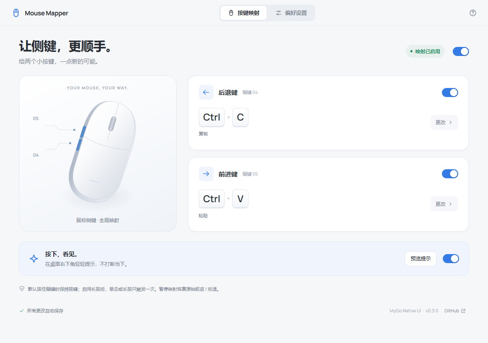
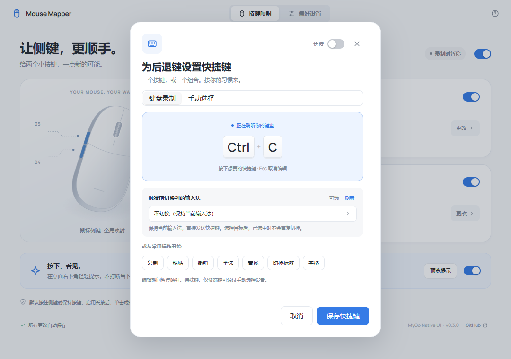
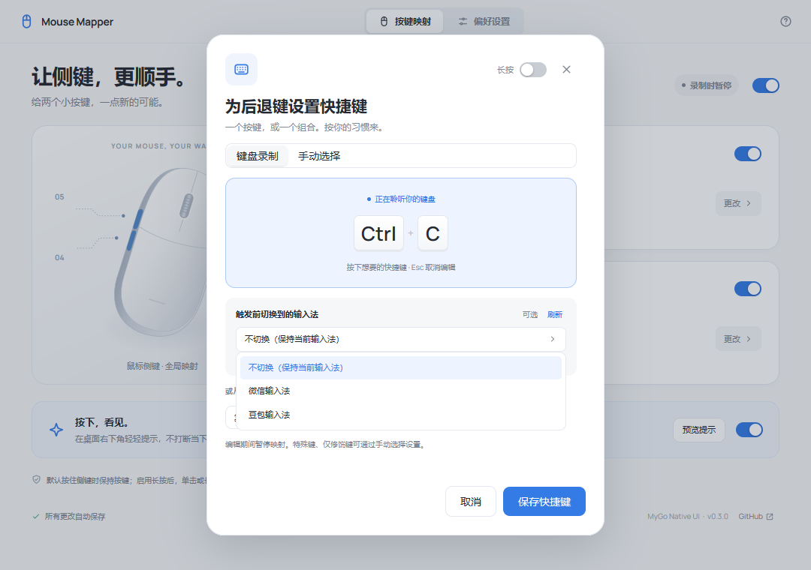
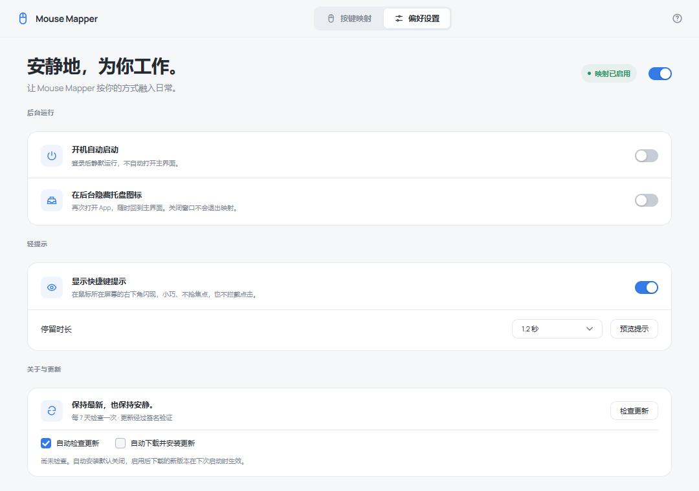

# Mouse Mapper

**让侧键，更顺手。** 给两个小按键，一点新的可能。

使用 [MyGo Native UI](https://github.com/egoist/mygo) 构建的 Windows / macOS 鼠标侧键映射应用。界面、托盘、按键提示与更新窗口全部使用 Go 原生实现，不依赖浏览器、WebView 或 JavaScript 运行时。

[下载](https://github.com/fondoger/mouse-mapper/releases) · [English](#english) · [更新记录](CHANGELOG.md) · [测试清单](docs/testing.md)



## 功能

- **分别映射前进、后退键。** 支持单个按键、组合键和仅修饰键；未配置长按时按下即触发，按住侧键保持按键，松开即释放。启用映射时拦截原始侧键，不同时执行前进／后退。
- **一个侧键，两种动作。** 可选长按映射，例如前进键单击 `Enter`、长按 `Esc`。启用后单击在松开时触发，达到阈值则立即触发一次长按动作，松开不再补发单击。阈值默认 **500 ms**，可设为 **100–5000 ms**。
- **即改即存。** 默认后退键复制、前进键粘贴；每个侧键可独立启停，也可一键暂停全部映射并恢复原始行为。
- **先切换输入法，再触发。** 每个动作可选一个已安装并启用的输入法，确认选中后才发送快捷键；如果当前已经是所选输入法，**直接发送快捷键，不再调用切换操作**。默认不切换，原有映射不受影响。
- **安静地常驻后台。** 关闭窗口后继续工作，可隐藏托盘；再次打开应用会找回已有主界面，而不是启动第二个映射进程。
- **随用户登录启动。** 系统级用户启动项，默认关闭；启用后登录时在后台运行。
- **按下，看见。** 可选的单行按键提示出现在鼠标所在屏幕的可用桌面**右下角**，而不是应用窗口角落。常见组合约 `112 × 38 DIP`，较长组合自动加宽；不抢焦点、不拦截点击，支持调整显示时长。
- **原生自动更新。** MyGo 内置更新器默认每 **7 天**检查一次；支持手动检查、查看说明、稍后提醒和跳过版本。自动下载并安装需用户主动开启。



## 平台与安装

| 平台 | 安装包 | 输入实现与运行要求 |
| --- | --- | --- |
| Windows 10 / 11，x64 / ARM64 | `Mouse.Mapper.Setup.….amd64.exe` / `….arm64.exe` | `WH_MOUSE_LL` + `SendInput`；不需要 WebView2。普通权限应用不能向高权限窗口或安全桌面注入按键。 |
| macOS 13+，Apple silicon / Intel | 通用 `.dmg`，另提供 `arm64` / `amd64` 包 | `CGEventTap` + `CGEventPost`；需要辅助功能与输入监控授权。 |

从 [Releases](https://github.com/fondoger/mouse-mapper/releases) 下载对应安装包：Windows 运行安装程序；macOS 打开 DMG 并将应用拖入 Applications，然后从 Applications 启动。首次在 macOS 使用时，在「系统设置 → 隐私与安全性」中的「辅助功能」和「输入监控」允许 Mouse Mapper，按应用提示重试或重新启动。

GitHub 会将安装包文件名中的空格改为点号，例如本地的 `Mouse Mapper Setup 0.3.0 amd64.exe` 下载后为 `Mouse.Mapper.Setup.0.3.0.amd64.exe`，通用 macOS 包为 `Mouse.Mapper.0.3.0.dmg`。校验和清单使用下载后的实际文件名。当前 Go 工具链生成的 Mac 程序最低需要 macOS 13；旧包元信息中曾写的 12.0 不代表支持 macOS 12，0.2.1 已修正声明。

**签名说明：** 更新归档使用 Ed25519 签名，但这与操作系统代码签名是两回事。目前 Windows 安装程序未做代码签名，macOS 使用 ad-hoc 签名，未配置 Developer ID 或 Apple 公证。SmartScreen / Gatekeeper 可能拦截下载的构建；请核对来源与 `SHA256SUMS.txt`，不要全局关闭系统安全保护。macOS 可选择本机从源码构建，或等待已公证的发行版。macOS 更新后也可能需要重新确认辅助功能授权。

部分鼠标厂商软件、游戏、远程桌面或系统快捷键可能先截获输入。CI 覆盖四种系统 / CPU 编译目标、Windows / macOS 单元测试和原生界面渲染；**编译和自动化测试不等于真实鼠标、权限与安装流程均已实机验收**。请参阅[测试清单](docs/testing.md)。

## 日常使用

在「按键映射」点击「更改」，录入组合键或手动选择，再保存。默认复制 / 粘贴使用 Windows 的 `Ctrl` 或 macOS 的 `Command`。录入期间会临时暂停映射，退出编辑后恢复，避免侧键干扰录入。

已启用的侧键映射会拦截按下、松开和额外的重复松开，即使输入法准备或按键发送失败，也不会回退成原始前进／后退。Windows 同样处理鼠标软件生成的模拟侧键事件；关闭对应映射或全局暂停后恢复原始行为。其他软件单独发送的浏览器命令、键盘快捷键或应用自行读取的原始设备数据并不是同一种侧键事件，不能靠侧键拦截保证阻止；如仍出现双重操作，请提供目标应用、鼠标型号及鼠标管理软件。

仅修饰键也可直接录制，例如同时按住 `Ctrl + Shift + Win`（macOS 为 `Control + Shift + Command`）；依次松开不会把组合缩减成最后一个键。全部松开后可继续重录，保存后重新打开仍保留完整组合。被系统拦截的按键可改用「手动选择」。

关闭主窗口不会退出。彻底停止映射请使用应用或托盘菜单的「退出」。隐藏托盘后，从开始菜单、Applications 或应用启动器再次打开 Mouse Mapper 即可恢复主界面。

### 单击与长按

更改侧键时开启「长按」，分别编辑「单击」和「长按」的按键与输入法，再设置长按阈值并保存。两种动作互斥：

| 配置与操作 | 触发时机 |
| --- | --- |
| 未配置长按 | 按下即触发；继续按住时保持输出键，松开时释放。 |
| 配置长按，未达到阈值就松开 | 松开时发送一次完整的单击按键组合。 |
| 配置长按，按住达到阈值 | 立即发送一次完整的长按按键组合；继续按住不重复，松开不触发单击。 |

例如，前进键的「单击」选择 `Enter`，「长按」通过「手动选择」选择 `Esc`，阈值设为 `500 ms`。录制时直接按 `Esc` 仍表示取消编辑，不会意外把它录入。前进、后退键可以独立启用长按，单击与长按也可以分别选择输入法。开启长按后，两种动作都是完整的按下／释放，不用于持续按住修饰键；需要按住 `Shift` 拖动等行为时，请关闭该侧键的长按功能。

只有判定出来的动作才会进行输入法准备；如果需要切换，会在确认目标输入法后发送按键，而不是承诺输入法切换零延迟。在等待期间切换到其他目标窗口／控件、暂停或更改映射，会取消待执行动作。旧版配置不会自动启用长按。


### 先切换输入法，再触发语音快捷键

1. 在系统中安装并启用微信输入法、豆包输入法或其他目标输入法；在该输入法自己的设置中开启语音输入，并确认其**实际配置的触发快捷键**。不同产品和版本没有统一的语音快捷键，Mouse Mapper 不会替你修改这些设置或授予麦克风权限。
2. 在「按键映射」中更改一个侧键，将其映射为该快捷键；在「触发前切换到的输入法」中选择目标，例如「微信输入法 (WeType)」。列表来自系统中已启用、可选中的输入法，安装或启用后可点击「刷新」。前进、后退键以及各自的单击、长按动作可以分别配置，也可选择「不切换（保持当前输入法）」。
3. 回到普通文本编辑器，保持目标应用在前台后按侧键。Mouse Mapper 每次都先读取实际目标的输入法身份：**当前已是所选输入法时直接发送快捷键，不调用切换或重新激活**；当前不是目标时才切换，并在确认选择稳定后发送快捷键。这个短暂的稳定窗口不代表厂商语音服务已就绪，语音功能是否响应仍取决于厂商设置、权限和当前应用。



Windows 使用 **TSF 的具体输入法配置**，macOS 使用 **TIS 输入源 ID**，不会仅凭“同为中文”把微信和豆包视为同一个输入法。Windows 通过与目标应用架构匹配的小型本机查询模块，读取**实际键盘焦点线程**已有的 TSF 状态，而不是把 Mouse Mapper 自己的输入法、语言标识或上次切换记录当作当前状态。微信与豆包即使共享同一个 HKL，也按各自的 CLSID／profile GUID 区分。查询模块只读取，不创建或激活目标线程的输入法服务。

若目标没有可读取的 TSF 上下文、拒绝查询、权限不兼容或查询超时，应用会报告错误并跳过该次动作，**不会猜测后再次激活**。无需切换输入法的映射不受此限制。确实需要切换时，Windows 的精确选择仍在**当前桌面会话**生效，不通过 `Win+Space` 轮换；开启系统“为每个应用窗口使用不同输入法”等选项时，请实测目标应用，其他窗口也可能跟随会话选择改变。

Windows ARM64 的精确输入法查询需要系统能准确识别目标进程架构（Windows 11 的 `ProcessMachineTypeInfo`）。旧版 Windows 10 ARM64 若不支持该能力，无法可靠区分原生与 x64 仿真目标时会拒绝查询，不猜测加载查询模块；普通按键映射不受影响。

选中的输入法会保持当前状态，**不会在快捷键结束后切回，也不会改写系统默认输入法设置**。切换失败、超时、检测到目标应用失焦，或在等待时暂停、修改配置、退出，都会跳过该次快捷键；已发生的输入法切换不会自动撤销。短按即使在等待期间已松开，也会在成功确认后发送一次完整按下 / 释放，避免丢失或卡键。macOS 的辅助功能和输入监控授权要求不变；其焦点保护以应用为单位，不检测同一应用内的窗口切换。

「预览提示」**只展示提示，不切换输入法，也不发送真实按键**。Windows 提示窗口使用原生圆角裁剪，避免透明画布出现黑色方形背景。



## 自动更新

- 使用 MyGo 官方 **`plugins/updater/native`**，包括更新提示、下载进度与重启窗口，整个流程都不需要 WebView。
- 默认开启后台检查，间隔 **7 天**。检查记录跨重启保存；应用运行时才会进行检查，也可随时手动检查。
- 默认不会静默下载安装；可在偏好设置或原生更新窗口中主动开启。更新安装完成后重启生效。
- 从本仓库的公开 GitHub Release 获取对应架构的更新清单，验证归档 SHA-256 的 **Ed25519 签名**后才允许安装。清单携带归档签名，并不是另行签名的 JSON 文件。
- 开发构建、不可写的安装位置不自动更新。Windows 推荐当前用户安装；macOS 应安装在用户有写权限的 Applications 目录，不要直接从 DMG 中运行。

## 本地开发

安装 **Go 1.27.1+**。MyGo **v0.5.5** 已作为 Go tool 依赖固定，无需全局安装 CLI，也没有前端构建链。界面与应用逻辑使用 Go；Windows 精确输入法查询另外使用两个极小的 C 本机模块，以便在目标应用的线程中只读采样。构建脚本自动下载校验过的固定版本编译器，无需全局安装 C 工具链，Go 应用仍保持 `CGO_ENABLED=0`。

```sh
git clone https://github.com/fondoger/mouse-mapper.git
cd mouse-mapper
go mod download
# Windows 开发／打包前执行；macOS 原生构建不需要此步
go run ./scripts/buildime
go tool mygo dev
```

```sh
# 单元测试、原生 UI 交互测试与静态检查
go test ./...
go vet ./...
go build -tags mygo_noinspector ./...

# Windows 打包前确认查询模块与当前源码一致
go run ./scripts/buildime -verify-only

# 当前平台的生产安装包，输出到 build/
go tool mygo build

# Windows x64 / ARM64
go tool mygo build -platform windows/amd64,windows/arm64

# macOS 通用版和单架构版；DMG 打包需在 macOS 上运行
go tool mygo build -platform darwin/universal,darwin/arm64,darwin/amd64
```

`buildime` 支持 Windows x64／ARM64 和 Linux x64 构建宿主，会将固定版 LLVM-MinGW 缓存到忽略提交的 `.mygo/toolchains/`，生成并嵌入 x64、ARM64 与 32 位目标应用的查询模块及哈希清单；32 位模块用于读取旧应用，不代表提供 32 位 Mouse Mapper。macOS 本机构建不需要这些模块；从 macOS 交叉打包 Windows 时请使用 Windows／Linux 构建宿主或 GitHub Actions。未生成模块的源码构建仍可运行普通映射，但精确 Windows 输入法查询会明确失败，不会退回不可靠的判断。CI 与 Windows 发布流程强制验证全部六个模块。

MyGo 默认 `CGO_ENABLED=0`。Windows 打包会按需下载并校验 NSIS；首次下载 Go 模块与打包工具需要联网。普通本地构建不需要更新私钥，不提供私钥时 MyGo 会跳过更新归档，只生成应用和安装包。

界面截图由 MyGo 原生渲染测试直接生成，并非网页效果图。设置 `MOUSE_MAPPER_UI_SNAPSHOTS` 为输出目录后，运行 `go test ./internal/desktop -run TestNativeSnapshots -count=1` 可重新生成。更多验收步骤见[测试清单](docs/testing.md)。

## 设置与隐私

| 平台 | 设置目录 |
| --- | --- |
| Windows | `%APPDATA%\Mouse Mapper\` |
| macOS | `~/Library/Application Support/Mouse Mapper/` |

`settings.json` 保存映射和后台偏好，`updater.json` 保存更新偏好、跳过版本与最近检查时间。可通过 `MOUSE_MAPPER_CONFIG_DIR` 指定隔离目录，供测试或便携使用。设置经过校验和原子替换；损坏或更新版本的配置不会被静默覆盖。

应用处理鼠标侧键与物理按键的按下 / 释放状态，防止映射后修饰键卡住；**不记录键入内容，不上传按键数据，没有账户或遥测服务**。自动更新会通过 HTTPS 访问 GitHub 获取版本信息与更新文件，可在设置中关闭后台检查。

「开机自启」实际指当前用户登录时启动：Windows 使用用户 Run 项，受支持的 macOS 13+ 使用系统登录项，可能需要在系统设置中批准。请在稳定的安装位置开启，移动或卸载应用前先关闭。自启动设置属于系统，不受测试配置目录隔离。

## 自动发布

推送匹配 `mygo.json` 版本的 **`vX.Y.Z` 标签会自动公开发布**，不需要人工批准草稿。务必在推送标签前完成测试和必要的实机验收。

1. 仓库管理员将现有更新私钥保存在 GitHub Actions Secret **`MYGO_UPDATER_PRIVATE_KEY`** 中，公钥保留在 `mygo.json` 的 `updates.publicKey`。私钥不要进入仓库、命令日志或构建产物，并另行安全备份。已经发布应用后，不要随意更换密钥。
2. 修改 `mygo.json` 的版本与 `CHANGELOG.md`，运行测试并提交，然后推送对应版本标签。
3. Actions 验证标签、仓库与密钥匹配，创建暂存草稿；在 Windows 和 macOS runner 上测试、打包，用 `go tool mygo build -upload` 上传安装包和签名更新文件。
4. 最终任务重新下载并验证全部安装包、五个更新通道、归档大小和 Ed25519 签名，并核对 macOS 最低系统版本声明与实际程序的每个架构切片，生成 `SHA256SUMS.txt` 后**自动公开发布**。普通版本成为 latest；带预发布后缀的版本标记为 prerelease，不替换稳定版更新源。

提供 `windows-amd64`、`windows-arm64`、`darwin-amd64`、`darwin-arm64`、`darwin-universal` 五个更新清单，保证单架构与通用版都能继续更新。失败的流水线只留下未公开草稿；不会自动暴露残缺更新，也不会覆盖已经公开的发行版。尚无旧版更新归档时，不会生成增量更新文件。

## English

Mouse Mapper is a quiet **Windows and macOS** utility built in Go with **MyGo Native UI** and tiny Windows native IME-query helpers. Map the back and forward mouse buttons to a key, shortcut, or held modifier; run in the background, hide the tray icon, launch at login, and optionally show brief, non-interactive shortcut feedback. The compact, single-line overlay sits at the **bottom-right of the usable desktop on the pointer's display**; ordinary shortcuts take about `112 × 38 DIP`, with additional width only for longer combinations. Windows uses a native rounded window region to avoid a black rectangular background. Reopening the app restores its existing window. There is no webview, JavaScript runtime, or frontend build chain.

**Optional long press:** without it, a side button sends key-down immediately and releases its keys on mouse-up. With it, release before the threshold sends one complete short-action tap; reaching the threshold immediately sends one complete long-action tap, with no repeats and no short action on release. Each button has its own **100–5000 ms** threshold (default **500 ms**), shortcut and optional input method for each action. For example, Forward can tap Enter and long-press Escape. Use the manual key picker for Escape; pressing it while recording cancels the editor. Existing settings do not enable long press automatically.

**Install:** choose a Windows x64 / ARM64 installer or the universal macOS DMG from [Releases](https://github.com/fondoger/mouse-mapper/releases). macOS 13+ requires Accessibility and Input Monitoring permissions. Windows integrity boundaries and other mouse software can prevent injection. Windows installers are not code-signed; macOS builds are ad-hoc signed, not Developer ID signed or notarized. Update signing does not replace OS code signing. Never disable system-wide security protections to run the app.

GitHub replaces spaces with dots in installer filenames: for example, `Mouse.Mapper.Setup.0.3.0.amd64.exe` or `Mouse.Mapper.0.3.0.dmg`. Published checksums use these actual download names; local build filenames retain spaces. The current Go toolchain emits a macOS 13 deployment target. Earlier packages' 12.0 Info.plist value did not provide macOS 12 compatibility; 0.2.1 corrects that declaration.

**Input method before shortcut:** each side button can optionally select an installed, enabled input method before sending its shortcut. The default is to leave the current input method unchanged. Choose the target in the native shortcut editor, then map the button to the hotkey configured in that input method's own voice-input settings; there is no universal WeChat/Doubao voice shortcut. Installation, enablement, vendor voice settings and microphone access remain the user's responsibility. Preview only displays feedback: it never changes the input method or injects keys.

**Already selected means no activation:** each trigger reads the exact current identity. If it matches the configured target, the shortcut proceeds without calling a selection or activation API. Windows queries the captured focus thread's existing TSF context through a matching-architecture native helper; a worker-thread profile, shared HKL, language match or last-selection cache is not evidence of the foreground IME. macOS compares the exact TIS input-source ID. Unknown, inaccessible or timed-out Windows identity fails closed with an error instead of blindly reactivating; ordinary no-IME mappings do not need this query.

Exact IME queries on Windows ARM64 require reliable process-machine information (`ProcessMachineTypeInfo` on Windows 11). Older Windows 10 ARM64 systems that cannot distinguish native and x64-emulated targets fail closed rather than loading a guessed helper architecture. Ordinary mappings remain available.

When a change is actually required, Windows selects the exact TSF profile for the desktop session rather than cycling. A brief observed stability window after selection is not a guarantee that the vendor's voice service is ready. Per-application Windows input settings can affect behavior and other windows may follow the session selection, so test the intended application. The selected input method stays active afterward without rewriting OS default-input preferences. Failure, timeout, cancellation or a detected foreground-app change skips the shortcut; a short click that finishes during a successful switch is delivered as one complete tap. macOS focus validation is app-level, not window-level within the same app, and its existing input permissions still apply.

**Updates:** the official `plugins/updater/native` plugin checks every **7 days by default**, preserves the last successful check across restarts, and supports manual checks. Automatic download/install is opt-in. Every update archive is verified against the embedded Ed25519 public key. Development builds and unwritable installations do not update themselves. Update checks contact GitHub over HTTPS; mouse mappings and typed content are never uploaded.

**Develop:** install Go 1.27.1+ and run `go mod download`. For Windows, run `go run ./scripts/buildime` before `go tool mygo dev` or packaging; the script downloads and verifies a pinned LLVM-MinGW compiler locally, then builds all six no-CRT query assets. Supported builder hosts are Windows x64/ARM64 and Linux x64. macOS native builds skip this step. MyGo v0.5.5 is pinned in `go.mod`; the Go application stays cgo-free. Use `go test ./...`, `go vet ./...`, and `go tool mygo build`; Windows CI requires embedded helpers and verifies source/PE hashes before publication. CI tests both native platforms and cross-compiles all four OS / CPU combinations. Automated fixtures and composed-overlay checks do not prove physical-device behavior, live IME switching or vendor voice activation. See the [manual acceptance checklist](docs/testing.md).

**Publish:** pushing a matching `v*` version tag automatically builds, signs update archives, verifies the complete staged release, and makes it public. `MYGO_UPDATER_PRIVATE_KEY` must be configured as an Actions secret; do not rotate the public key after shipping without a migration plan. Stable tags become the latest update source; prereleases do not.

## Credits & License

[MIT](LICENSE) © 2026 fondoger.

Built with [MyGo](https://github.com/egoist/mygo), [purego](https://github.com/ebitengine/purego), [go-text](https://github.com/go-text/typesetting), and Go's `x/sys`, `x/image`, `x/text` packages. The embedded [Manrope](https://github.com/googlefonts/manrope) font is distributed under the **SIL Open Font License 1.1**; system fonts provide appropriate script fallback. Original third-party notices are included in [resources/licenses](resources/licenses) and every packaged application.
